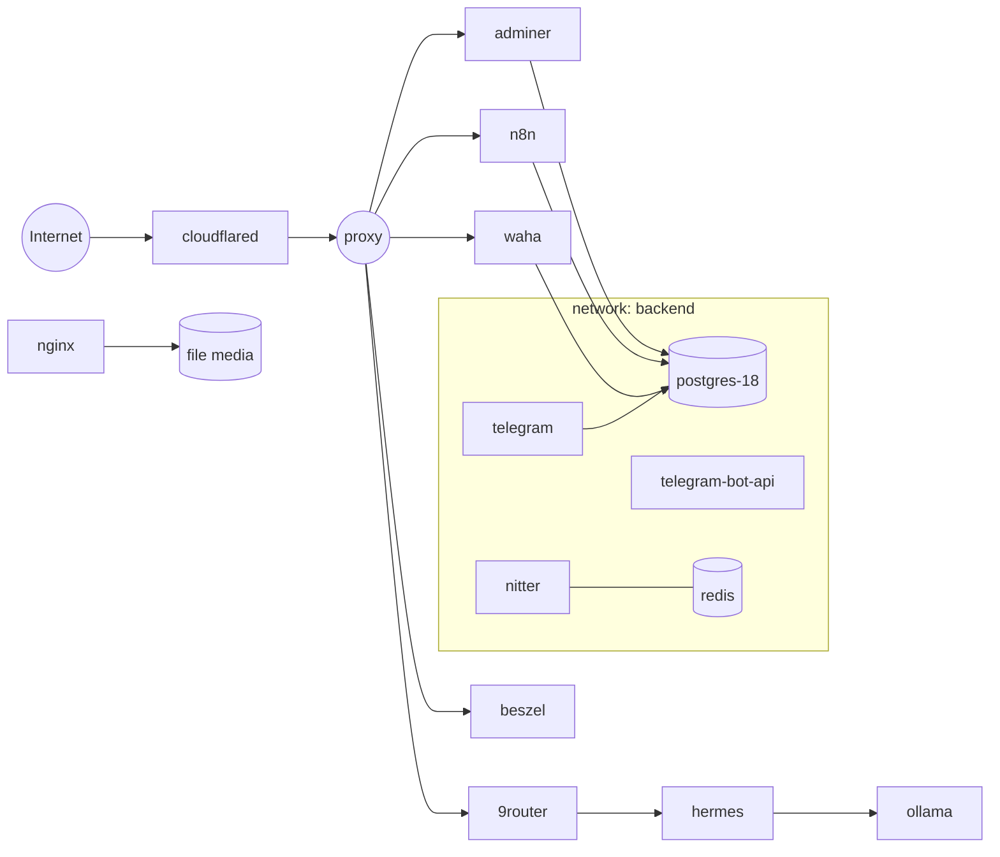

# Oracle Infrastructure

Kumpulan stack layanan **self-hosted** yang dijalankan dengan Docker Compose di satu VPS (Oracle Cloud ARM / Ampere). Setiap layanan berada di folder terpisah dan merupakan **project Compose independen**, sehingga bisa di-deploy, di-restart, atau di-update tanpa mengganggu layanan lain.

Ingress publik ditangani oleh **Cloudflare Tunnel**, sedangkan akses monitoring internal memakai **Tailscale**. Semua container memakai log rotation (`json-file`, 20 MB × 5) agar disk tidak cepat penuh.


> **Catatan keamanan:** repo ini publik. Tidak ada file `.env`, session, atau credential yang di-commit — hanya file `.env.example` berisi placeholder. Lihat [Keamanan](#keamanan).

---

## Daftar Isi

- [Arsitektur](#arsitektur)
- [Layanan](#layanan)
- [Struktur Repository](#struktur-repository)
- [Prasyarat](#prasyarat)
- [Setup Jaringan](#setup-jaringan)
- [Konfigurasi Environment](#konfigurasi-environment)
- [Menjalankan Layanan](#menjalankan-layanan)
- [Setup Pertama Kali](#setup-pertama-kali)
- [Operasional Harian](#operasional-harian)
- [Backup & Restore](#backup--restore)
- [Keamanan](#keamanan)
- [Troubleshooting](#troubleshooting)
- [Konvensi](#konvensi)

---

## Arsitektur



Semua jaringan di atas adalah **external network** yang dibuat sekali di host, bukan dibuat otomatis oleh Compose. Tujuannya agar container dari project berbeda bisa saling berkomunikasi lewat nama service.

| Network | Fungsi | Anggota |
| --- | --- | --- |
| `proxy` | Ingress dari Cloudflare Tunnel ke layanan HTTP | `cloudflared`, `n8n`, `waha`, `9router`, `beszel`, `adminer` |
| `backend` | Data plane internal (DB, bot, scraper) | `postgres-18`, `telegram`, `telegram-bot-api`, `nitter`, `nitter-redis`, `adminer`, `n8n`, `waha` |
| `hermes` | Isolasi agent AI dan dependensinya | `hermes`, `9router` |
| `ollama` | Runtime LLM lokal (internal) | `ollama` |
| `nginx` | Penyajian file media statis | `nginx` |

---

## Layanan

| Folder | Image / Build | Fungsi | Network | Port Host |
| --- | --- | --- | --- | --- |
| `9router/` | `decolua/9router:latest` | Router/API gateway LLM dengan API key & JWT | `proxy`, `hermes` | – |
| `adminer/` | `adminer:latest` | Web UI untuk PostgreSQL | `proxy`, `backend` | – |
| `beszel/` | `henrygd/beszel` + `beszel-agent` | Monitoring resource server & container | `proxy`, host | `8090` |
| `cloudflared/` | `cloudflare/cloudflared:latest` | Tunnel ingress tanpa membuka port publik | `proxy` | – |
| `hermes/` | `nousresearch/hermes-agent:latest` | Agent AI berbasis gateway (Telegram) | `hermes` | – |
| `iopaint/` | build lokal | Inpainting / penghapus objek gambar (CPU) | default | `8083` |
| `n8n/` | `docker.n8n.io/n8nio/n8n` | Otomasi workflow & integrasi | `proxy`, `backend` | – |
| `nginx/` | `nginx:stable-alpine` | Sajikan file media statis untuk layanan lain | `nginx` | `8080` |
| `nitter/` | `zedeus/nitter:latest` + `redis:6-alpine` | Frontend alternatif Twitter/X + RSS | `backend` | `8082` |
| `ocr-checker/` | build lokal | Cek gambar channel Telegram dengan Tesseract OCR | default | – |
| `ollama/` | `ollama/ollama` | Runtime LLM lokal | `ollama` | – |
| `postgres/` | `postgres:18-trixie` | Database utama | `backend` | `5432` |
| `telegram/` | build lokal | Bot admin: manajemen profil, cookie, dan scraper | `backend` | – |
| `telegram-bot-api/` | `aiogram/telegram-bot-api:latest` | Telegram Bot API server lokal | `backend` | – |
| `waha/` | `devlikeapro/waha:gows-arm` | WhatsApp HTTP API (engine GOWS) | `proxy`, `backend` | – |

Port yang hanya ditandai “–” diakses melalui jaringan Docker (nama container/service), bukan langsung dari host. Port `8090` dan `8082` sengaja dibuka untuk akses monitoring lewat Tailscale.

---

## Struktur Repository

```text
oracle-infrastructure/
├── 9router/
│   ├── .env.example
│   └── compose.yaml
├── adminer/
│   └── compose.yaml
├── beszel/
│   ├── .env.example
│   └── compose.yaml
├── cloudflared/
│   ├── .env.example
│   └── compose.yaml
├── hermes/
│   ├── .env.example
│   └── compose.yaml
├── iopaint/
│   ├── Dockerfile
│   └── compose.yaml
├── n8n/
│   ├── .env.example
│   └── compose.yaml
├── nginx/
│   └── compose.yaml
├── nitter/
│   ├── README.md
│   ├── compose.yaml
│   └── nitter.example.conf
├── ocr-checker/
│   ├── app/
│   ├── config/
│   ├── results/
│   ├── sessions/
│   ├── Dockerfile
│   ├── README.md
│   ├── compose.yaml
│   └── requirements.txt
├── ollama/
│   └── compose.yaml
├── postgres/
│   └── postgres-18/
│       ├── .env.example
│       └── compose.yaml
├── telegram/
│   ├── bots/
│   ├── config/
│   ├── database/
│   ├── states/
│   ├── utils/
│   ├── Dockerfile
│   ├── compose.yaml
│   └── requirements.txt
├── telegram-bot-api/
│   ├── .env.example
│   └── compose.yaml
├── waha/
│   ├── .env.example.gows
│   ├── .env.example.webjs
│   └── compose.yaml
├── .gitignore
└── README.md
```

Folder `data/`, `sessions/`, `results/`, dan file `.env` **tidak** masuk repository — dibuat otomatis saat runtime atau harus disiapkan manual di host.

---

## Prasyarat

- **Docker Engine** ≥ 24 dan **Docker Compose v2** (`docker compose`)
- Linux host (diuji pada VPS ARM64 / Oracle Cloud Ampere)
- Akses SSH ke host dengan user yang masuk grup `docker`
- Opsional:
  - **Tailscale** untuk akses monitoring internal
  - **Cloudflare Tunnel token** untuk ingress publik
  - Akun Telegram (API ID/Hash) dan WhatsApp untuk layanan terkait

Verifikasi:

```bash
docker --version
docker compose version
```

---

## Setup Jaringan

Buat semua external network satu kali di host. Perintah ini aman diulang — Docker akan memberi tahu jika network sudah ada.

```bash
docker network create proxy
docker network create backend
docker network create hermes
docker network create ollama
docker network create nginx
```

Cek hasilnya:

```bash
docker network ls
```

> Compose akan gagal dengan error `network ... not found` jika salah satu network di atas belum dibuat.

---

## Konfigurasi Environment

Setiap layanan yang membutuhkan konfigurasi memiliki pasangan file:

```text
<service>/.env.example   → template, aman di-commit
<service>/.env           → konfigurasi asli, TIDAK di-commit
```

Salin template lalu isi nilainya:

```bash
cd n8n
cp .env.example .env
chmod 600 .env
nano .env
```

Ringkasan variabel yang wajib diisi:

| Layanan | File template | Variabel wajib |
| --- | --- | --- |
| `9router` | `.env.example` | `JWT_SECRET`, `API_KEY_SECRET`, `MACHINE_ID_SALT`, `INITIAL_PASSWORD` |
| `beszel` | `.env.example` | `APP_URL`, `BESZEL_KEY`, `BESZEL_TOKEN` (dari dashboard Beszel) |
| `cloudflared` | `.env.example` | `TUNNEL_TOKEN` |
| `hermes` | `.env.example` | `TELEGRAM_BOT_TOKEN`, `TELEGRAM_ALLOWED_USERS` |
| `n8n` | `.env.example` | `N8N_HOST`, `WEBHOOK_URL`, `N8N_EDITOR_BASE_URL` |
| `postgres-18` | `.env.example` | `POSTGRES_DB`, `POSTGRES_USER`, `POSTGRES_PASSWORD` |
| `telegram` | `.env.example` | `DB_*`, `ADMIN_ID`, `ADMIN_BOT_TOKEN`, `TELEGRAM_MESSAGE_LIMIT` |
| `telegram-bot-api` | `.env.example` | `TELEGRAM_API_ID`, `TELEGRAM_API_HASH` |
| `ocr-checker` | `.env.example` | `TELEGRAM_API_ID`, `TELEGRAM_API_HASH` |
| `waha` | `.env.example.gows` atau `.env.example.webjs` | `WAHA_API_KEY`, `WAHA_DASHBOARD_*`, `WHATSAPP_SWAGGER_*` |

Beberapa layanan memakai file konfigurasi tambahan yang juga tidak di-commit:

| File | Layanan | Catatan |
| --- | --- | --- |
| `nginx/nginx.conf` | `nginx` | Di-ignore oleh pola `*.conf`; harus dibuat di host |
| `nitter/nitter.conf` | `nitter` | Mulai dari `nitter.example.conf` |
| `nitter/sessions.jsonl` | `nitter` | Token session akun X/Twitter |

---

## Menjalankan Layanan

Karena setiap folder adalah project Compose terpisah, deploy dilakukan per layanan:

```bash
cd n8n
docker compose up -d
```

Untuk membangun image lokal (`telegram`, `ocr-checker`, `iopaint`):

```bash
cd telegram
docker compose up -d --build
```

Deploy semua layanan sekaligus (yang sudah punya `.env` valid):

```bash
for dir in 9router adminer beszel cloudflared hermes iopaint n8n nginx nitter ocr-checker ollama postgres/postgres-18 telegram telegram-bot-api waha; do
  echo "==> $dir"
  (cd "$dir" && docker compose up -d)
done
```

Cek status seluruh container:

```bash
docker ps --format "table {{.Names}}\t{{.Status}}\t{{.Image}}"
```

---

## Setup Pertama Kali

Beberapa layanan butuh langkah inisialisasi sebelum bisa dipakai normal.

### nitter

```bash
cd nitter
cp nitter.example.conf nitter.conf
# sesuaikan redisHost = "nitter-redis"
# siapkan sessions.jsonl dari akun X/Twitter
docker compose up -d
```

### ocr-checker

```bash
cd ocr-checker
docker compose run --rm ocr-checker python -m app.login
docker compose run --rm ocr-checker python -m app.get_channels
docker compose up -d
```

Detail lengkap ada di [`ocr-checker/README.md`](ocr-checker/README.md).

### waha

```bash
cd waha
cp .env.example.gows .env   # atau .env.example.webjs
# isi API key dan kredensial dashboard
docker compose up -d
```

Pairing WhatsApp dilakukan lewat dashboard/QR setelah container berjalan.

### beszel

1. Jalankan `docker compose up -d`.
2. Buka dashboard `http://<host>:8090`, buat admin.
3. Salin `KEY` dan `TOKEN` dari menu agent ke `beszel/.env`.
4. `docker compose up -d` ulang agar `beszel-agent` terhubung.

### telegram

Membutuhkan database yang sudah berjalan:

```bash
cd postgres/postgres-18
docker compose up -d

cd ../../telegram
docker compose up -d --build
```

Pastikan `DB_HOST` menunjuk ke `postgres-18` (nama container) atau host yang sesuai.

---

## Operasional Harian

```bash
# Log realtime
docker compose logs -f --tail=100

# Restart satu layanan
docker compose restart

# Hentikan tanpa menghapus data
docker compose down

# Tarik image terbaru lalu recreate
docker compose pull && docker compose up -d

# Rebuild image lokal
docker compose up -d --build
```

Monitoring resource:

```bash
docker stats --no-stream
df -h
docker system df
```

Pembersihan aman (tidak menyentuh volume aktif):

```bash
docker image prune -f
docker builder prune -f
```

> Hindari `docker system prune -a --volumes` di host produksi — perintah itu bisa menghapus volume database.

---

## Backup & Restore

Data persisten berada di folder bind-mount di dalam repo. Yang wajib di-backup:

| Path | Isi |
| --- | --- |
| `postgres/postgres-18/data/` | Seluruh database PostgreSQL |
| `n8n/n8n_data/` | Workflow, credential, dan history n8n |
| `waha/sessions/`, `waha/media/` | Session dan media WhatsApp |
| `ocr-checker/sessions/` | Session Telegram (setara kredensial login) |
| `nitter/sessions.jsonl` | Token session X/Twitter |
| `*/.env` | Seluruh konfigurasi dan secret |
| `hermes/data/`, `hermes/workspace/` | State dan workspace agent |
| `ollama/data/` | Model LLM yang sudah diunduh (besar, opsional) |

Backup database secara logis (paling aman untuk restore antar versi):

```bash
docker exec postgres-18 pg_dump -U "$POSTGRES_USER" "$POSTGRES_DB" \
  > backup-$(date +%F).sql
```

Backup seluruh konfigurasi (kecuali data besar) ke arsip terenkripsi:

```bash
tar czf infra-config-$(date +%F).tar.gz \
  --exclude='*/data' --exclude='*/n8n_data' --exclude='*/sessions' \
  .
```

**Simpan `.env`, `sessions/`, dan dump database di tempat terenkripsi, bukan di cloud plain-text.**

---

## Keamanan

Prinsip yang diterapkan di repo ini:

- **Tidak ada secret di Git.** `.env`, `*.conf`, session, dan data runtime di-ignore. Hanya `.env.example` berisi placeholder yang di-commit.
- **Ingress tanpa port publik.** Cloudflare Tunnel membuat koneksi keluar, sehingga VPS tidak perlu membuka port HTTP ke internet.
- **Least privilege.** Beberapa container memakai `no-new-privileges`, `read_only`, `cap_drop: ALL`, dan user non-root (`nitter`, `nitter-redis`).
- **Resource limit.** Layanan berat (`hermes`, `9router`, `ollama`, `iopaint`) dibatasi CPU/memori agar tidak menghabiskan host.
- **Log rotation.** Semua container memakai `json-file` dengan batas 20 MB × 5 file.

Yang perlu diperhatikan:

- Repo ini **publik**. Jangan pernah menambahkan kredensial asli, IP internal, atau data pelanggan ke file yang di-track.
- File `telegram.session`, `sessions.jsonl`, dan folder `waha/sessions/` **setara kredensial login**. Jika bocor, orang lain bisa mengambil alih akun.
- `beszel-agent` me-mount `/var/run/docker.sock` (read-only). Akses ke socket Docker tetap sangat sensitif — batasi akses ke host.
- Port `5432`, `8090`, `8082`, `8083`, `8080` terbuka di host. Gunakan firewall/Tailscale agar hanya bisa diakses dari jaringan tepercaya.
- Jika ada secret yang tidak sengaja ter-commit, **rotate** secret tersebut. Menghapus file di commit berikutnya tidak menghilangkannya dari history.

---

## Troubleshooting

| Gejala | Penyebab umum | Solusi |
| --- | --- | --- |
| `network proxy not found` | External network belum dibuat | Jalankan [Setup Jaringan](#setup-jaringan) |
| `permission denied` saat akses `docker.sock` | User tidak masuk grup `docker` | `sudo usermod -aG docker $USER` lalu login ulang |
| Container restart terus | `.env` belum ada / variabel kosong | `docker compose config` lalu `docker compose logs` |
| `port is already allocated` | Port host dipakai proses lain | `ss -tulpn \| grep <port>` lalu ubah mapping |
| n8n tidak bisa diakses dari luar | `N8N_HOST` / `WEBHOOK_URL` salah | Samakan dengan domain tunnel, recreate container |
| nitter healthcheck gagal | `sessions.jsonl` tidak valid/expired | Buat ulang session token |
| `no space left on device` | Image/log/data menumpuk | `docker system df`, `docker image prune -f` |
| Bot Telegram tidak merespons | `ADMIN_BOT_TOKEN` salah atau DB tidak reachable | Cek log `telegram`, pastikan `postgres-18` sehat |

Debug cepat:

```bash
docker compose config          # validasi compose + interpolasi env
docker inspect <container>     # cek mount, network, env
docker exec -it <container> sh # masuk ke container
```

---

## Konvensi

Saat menambah layanan baru, ikuti pola berikut:

1. Buat folder baru: `<service>/`.
2. Tambahkan `compose.yaml` dengan `container_name` yang eksplisit.
3. Tambahkan `.env.example` (placeholder saja) jika butuh konfigurasi; `.env` asli tidak di-commit.
4. Sambungkan ke external network yang sesuai — jangan buat network baru tanpa alasan jelas.
5. Tambahkan `restart: unless-stopped` dan blok `logging` (json-file, 20 MB × 5).
6. Tambahkan resource limit untuk layanan yang berpotensi boros CPU/memori.
7. Perbarui tabel [Layanan](#layanan) dan [Konfigurasi Environment](#konfigurasi-environment) di README ini.

---

## Lisensi

Belum ditentukan. Repository bersifat publik untuk keperluan referensi pribadi; hubungi pemilik (`@qiau`) sebelum menggunakan ulang secara komersial.
