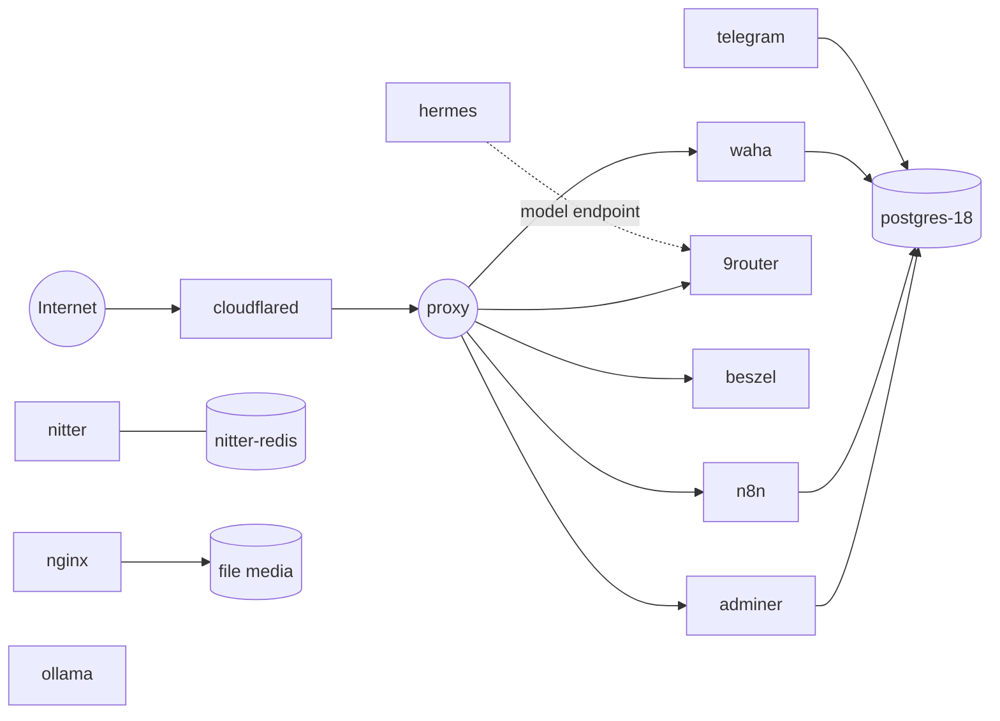

# Oracle Infrastructure

Kumpulan layanan **self-hosted** di satu VPS Oracle Cloud (ARM64 / Ampere) yang dijalankan dengan Docker Compose. Setiap folder adalah **project Compose independen**, sehingga bisa di-deploy, di-restart, atau di-update tanpa mengganggu layanan lain.

Ingress publik ditangani **Cloudflare Tunnel** (tanpa membuka port HTTP ke internet), sedangkan monitoring internal diakses lewat **Tailscale**. Semua container memakai log rotation `json-file` 20 MB × 5 agar disk tidak cepat penuh.


> **Keamanan:** repo ini publik. Tidak ada `.env`, session, atau credential yang di-commit — hanya template `.env.example` berisi placeholder.

---

## Arsitektur



Semua network adalah **external network** yang dibuat sekali di host, bukan dibuat otomatis oleh Compose. Tujuannya agar container dari project berbeda bisa saling berkomunikasi lewat nama service.

| Network | Fungsi | Anggota |
| --- | --- | --- |
| `proxy` | Ingress dari Cloudflare Tunnel ke layanan HTTP | `cloudflared`, `n8n`, `waha`, `9router`, `beszel`, `adminer` |
| `backend` | Data plane internal (database, bot, scraper) | `postgres-18`, `telegram`, `telegram-bot-api`, `nitter`, `nitter-redis`, `adminer`, `n8n`, `waha` |
| `hermes` | Isolasi agent AI dan router model | `hermes`, `9router` |
| `ollama` | Runtime LLM lokal | `ollama` |
| `nginx` | Penyajian file media statis | `nginx` |

---

## Layanan

| Folder | Fungsi | Dokumentasi |
| --- | --- | --- |
| [`9router/`](9router/) | Router/API gateway LLM dengan endpoint OpenAI-compatible | `compose.yaml`, `.env.example` |
| [`adminer/`](adminer/) | Web UI untuk PostgreSQL | `compose.yaml` |
| [`beszel/`](beszel/) | Monitoring resource server & container | `compose.yaml`, `.env.example` |
| [`cloudflared/`](cloudflared/) | Tunnel ingress tanpa membuka port publik | `compose.yaml`, `.env.example` |
| [`hermes/`](hermes/) | Agent AI Nous Research via gateway Telegram | [`README.md`](hermes/README.md) |
| [`iopaint/`](iopaint/) | Inpainting / penghapus objek gambar (CPU) | `Dockerfile`, `compose.yaml` |
| [`n8n/`](n8n/) | Otomasi workflow & integrasi | `compose.yaml`, `.env.example` |
| [`nginx/`](nginx/) | Menyajikan file media statis | `compose.yaml` |
| [`nitter/`](nitter/) | Frontend alternatif X/Twitter + RSS | [`README.md`](nitter/README.md) |
| [`ocr-checker/`](ocr-checker/) | Cek gambar channel Telegram dengan Tesseract OCR | [`README.md`](ocr-checker/README.md) |
| [`ollama/`](ollama/) | Runtime LLM lokal | `compose.yaml` |
| [`postgres/`](postgres/) | Database utama | `postgres-18/compose.yaml`, `.env.example` |
| [`telegram/`](telegram/) | Bot admin: profil, cookie, dan scraper | `Dockerfile`, `compose.yaml` |
| [`telegram-bot-api/`](telegram-bot-api/) | Telegram Bot API server lokal | `compose.yaml`, `.env.example` |
| [`waha/`](waha/) | WhatsApp HTTP API (engine GOWS) | `compose.yaml`, `.env.example.gows` |

Detail teknis tiap layanan ada di README folder masing-masing. Untuk layanan yang belum punya README, konfigurasi ada di `compose.yaml` dan `.env.example`.

---

## Struktur Repository

```text
oracle-infrastructure/
├── <service>/            # satu folder per layanan
│   ├── compose.yaml      # definisi service
│   ├── .env.example      # template konfigurasi (opsional)
│   ├── Dockerfile        # hanya untuk build lokal
│   └── README.md         # detail teknis (bila tersedia)
├── postgres/postgres-18/ # database utama
├── .gitignore
└── README.md
```

Folder runtime seperti `data/`, `sessions/`, dan `results/` berisi state/kredensial dan **tidak untuk di-commit**.

---

## Quick Start

**Prasyarat:** Docker Engine ≥ 24, Docker Compose v2, Linux host (diuji di ARM64), dan user yang masuk grup `docker`.

```bash
docker --version
docker compose version
```

**1. Buat external network** (sekali saja, aman diulang):

```bash
docker network create proxy
docker network create backend
docker network create hermes
docker network create ollama
docker network create nginx
```

**2. Siapkan konfigurasi** untuk layanan yang memerlukannya:

```bash
cd n8n
cp .env.example .env
chmod 600 .env
nano .env
```

> `waha` memakai `.env.example.gows` atau `.env.example.webjs`. Layanan tanpa `.env.example` tidak butuh konfigurasi tambahan.

**3. Jalankan layanan:**

```bash
cd <service>
docker compose up -d

# untuk image build lokal: telegram, ocr-checker, iopaint
docker compose up -d --build
```

**4. Cek status:**

```bash
docker ps --format "table {{.Names}}\t{{.Status}}\t{{.Image}}"
```

Langkah inisialisasi khusus (mis. login Telegram, session Nitter, pairing WhatsApp, agent Hermes) ada di README folder terkait, atau di `compose.yaml` / `.env.example` bila README belum tersedia.

---

## Keamanan

- **Tidak ada secret di Git.** `.env` dan `*.conf` di-ignore; session serta data runtime tidak boleh di-commit. Hanya `.env.example` berisi placeholder yang masuk repository.
- **Ingress tanpa port publik.** Cloudflare Tunnel membuat koneksi keluar, jadi VPS tidak perlu membuka port HTTP.
- **Least privilege & resource limit.** Beberapa container memakai `no-new-privileges`, `read_only`, `cap_drop: ALL`, user non-root, serta batas CPU/memori.
- **Port host yang terbuka:** `5432` (Postgres), `8080` (nginx), `8082` (nitter), `8083` (iopaint), `8090` (beszel). Batasi lewat firewall atau Tailscale.
- **File session setara kredensial.** `telegram.session`, `sessions.jsonl`, dan `waha/sessions/` bisa dipakai mengambil alih akun. Jika bocor, **rotate** session tersebut.

---

## Konvensi Singkat

Saat menambah layanan baru:

1. Buat folder `<service>/` dengan `compose.yaml` dan `container_name` eksplisit.
2. Sertakan `.env.example` (placeholder saja) bila butuh konfigurasi.
3. Sambungkan ke external network yang sesuai — jangan buat network baru tanpa alasan.
4. Tambahkan `restart: unless-stopped` dan blok `logging` (json-file, 20 MB × 5).
5. Tulis detail teknisnya di `README.md` dalam folder tersebut, lalu daftarkan di tabel [Layanan](#layanan).

---

## Lisensi

Belum ditentukan. Repository bersifat publik untuk referensi pribadi; hubungi pemilik (`@qiau`) sebelum menggunakan ulang secara komersial.
